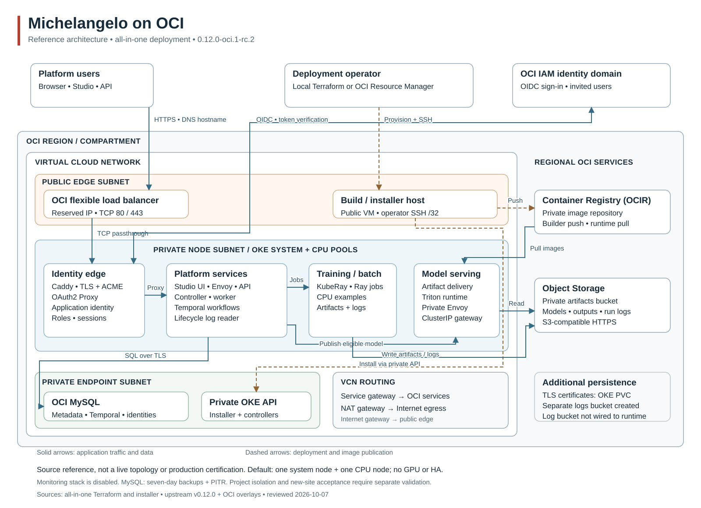

# Michelangelo on OCI

Deploy Michelangelo AI on Oracle Cloud Infrastructure with private OKE workloads, OCI IAM sign-in, managed MySQL, Object Storage, and private Container Registry.

**Distribution: 0.12.0-oci.1 · Upstream: Michelangelo v0.12.0**

The distribution combines pinned upstream source with OCI deployment infrastructure and integration overlays. It provides Studio access, training and evaluation workflows, model registration, batch prediction, and private model serving. Customers operate the deployment in their own OCI tenancy.

## Choose a deployment path

| Package | Includes | Use |
| --- | --- | --- |
| `michelangelo-all-in-one-0.12.0-oci.1.zip` | Infrastructure, application installation, IAM integration, and eight lifecycle examples | Complete deployment into an existing compartment |
| `michelangelo-terraform-0.12.0-oci.1.zip` | Infrastructure foundation and a new child compartment | Local Terraform; application installation is separate |
| `michelangelo-resource-manager-0.12.0-oci.1.zip` | Infrastructure foundation with OCI Console forms | Resource Manager; application installation is separate |

Use **all-in-one** for a complete installation. Each path owns an independent Terraform state. Do not apply multiple paths to the same resources. Foundation stacks do not automatically hand off to the all-in-one installer.

## Start here

1. Review [requirements and installation](docs/installation.md), including tenancy permissions, capacity, IAM, and network access.
2. Obtain the versioned package and its SHA-256 file from the repository's [Releases](https://github.com/subhanchaudry/michelangelo-on-oci/releases). Verify the checksum before extraction.
3. Deploy from the extracted package and open the resulting `application_url`.
4. Follow the [operations guide](docs/operations.md) for access, model workflows, monitoring, backup, and recovery.

## Documentation

- [Architecture](docs/architecture.md): components, request flows, and deployment boundaries.
- [Installation](docs/installation.md): local Terraform and OCI Resource Manager instructions.
- [Operations](docs/operations.md): lifecycle workflows, access, monitoring, upgrades, and recovery.
- [Security and operating boundaries](docs/security.md): identity, permissions, network exposure, and site responsibilities.
- [Release notes](docs/release-notes.md): package contents and compatibility.
- [License](LICENSE) and [third-party notices](THIRD-PARTY-NOTICES.md).

## Upstream and compatibility

[Michelangelo AI](https://github.com/michelangelo-ai/michelangelo) is Uber's open-source ML platform. This distribution pins [v0.12.0 at ed2a2b0](https://github.com/michelangelo-ai/michelangelo/tree/ed2a2b09ed9fab57e1479f45e84330a78f3ff8d3); newer upstream documentation may describe different behavior. Upstream features labeled **Coming soon**, including Studio resource views, retain that status.

The included configuration uses Temporal, Ray, Triton, MySQL, OCI IAM, Object Storage, and OCIR. It is a CPU deployment with one system node and one CPU node by default. High availability, project-level team isolation, GPU workloads, and migration of an existing site's history are outside this configuration. See the operating boundaries before selecting a customer deployment topology.

This repository supplies deployment software; it does not establish an Oracle or Uber managed-service support commitment. Upstream components and dependencies retain their respective licenses and support arrangements.
