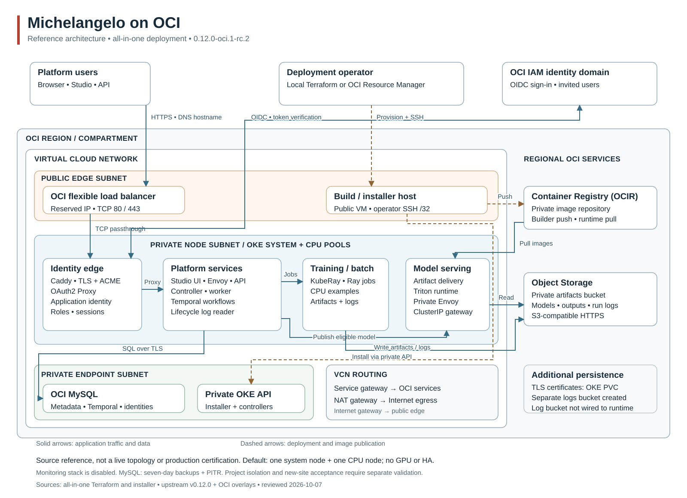

# Michelangelo on OCI reference architecture

This view documents the source of the all-in-one **0.13.0-oci.1-rc.2** package, using upstream Michelangelo **v0.13.0** with OCI overlays. The diagram describes the packaged deployment topology. The `terraform/` and `resource-manager/` foundation alternatives do not install these application services.

## Read the diagram

1. **Browser access:** DNS resolves to the reserved public IP on an OCI flexible load balancer in the public edge subnet. TCP ports 80 and 443 pass to the OKE identity edge. Caddy terminates TLS and manages ACME certificates; OAuth2 Proxy uses OCI IAM OIDC, then the application identity service checks application access before forwarding to Studio. Studio proxies API requests through Envoy. Certificates persist on an OKE PVC. No inference service is exposed as a separate public load balancer.
2. **Application and ML execution:** private OKE nodes run Studio, API, controllers, workers, Temporal and the lifecycle log reader. Controllers coordinate Ray training/batch jobs through KubeRay and model delivery to Triton. An internal Envoy Gateway uses a ClusterIP service. The default pools have one system node and two CPU workers. GPU nodes are not configured. Component boxes are logical groupings, not dedicated node pools or enforced network isolation boundaries.
3. **Data:** OCI MySQL in the private endpoint subnet persists application metadata, Temporal state and application identities. Remote MySQL connections use verified TLS with certificate checks; the application metadata path includes a MySQL Router sidecar. MySQL has seven-day backups and PITR configured. Private Object Storage holds models, run outputs and lifecycle logs through its HTTPS S3-compatible endpoint. A separate logs bucket is provisioned but the installer does not bind it to the lifecycle log runtime; do not infer a separate active logging pipeline from that resource.
4. **Deployment:** local Terraform or OCI Resource Manager provisions resources and invokes the public build host over SSH. Local access is restricted to the operator IPv4 `/32`; Resource Manager can use its optional private endpoint, omitted from this overview. The host builds from pinned source plus overlays, publishes images to private OCIR, and installs through the private OKE API. Runtime workloads pull images using the configured reader credentials. Publisher and reader machine accounts are separate from human Studio users. Keep the host available for reruns and upgrades; it may be stopped between installer runs.
5. **Routing:** the public edge uses an Internet Gateway. Private subnets route OCI service-network traffic through a Service Gateway and other outbound Internet traffic through a NAT Gateway. The build host also downloads upstream source and dependencies; DNS and ACME certificate issuance are external prerequisites. Gateway routing is shown as a note to keep the component flows readable. Arrows summarize primary dependencies, not every network connection or port.

## Scope and operating limits

This customer-operated configuration uses one system node and two CPU workers by default. High availability and project-level team isolation are outside its scope. The upstream bundled monitoring stack is disabled; the package provides optional OCI alarms and owner notifications. See [operations](operations.md) for backup, recovery, upgrades, and resource inspection.

## Evidence in the deployment source

These links identify the files in the GitHub source repository; extracted release ZIPs retain this guide and its images.

| Area | Source |
| --- | --- |
| VCN, subnet and gateway placement | [network.tf](https://github.com/subhanchaudry/michelangelo-on-oci/blob/main/all-in-one/network.tf) |
| OKE private endpoint and node pools | [oke.tf](https://github.com/subhanchaudry/michelangelo-on-oci/blob/main/all-in-one/oke.tf) |
| MySQL, buckets and OCIR | [platform.tf](https://github.com/subhanchaudry/michelangelo-on-oci/blob/main/all-in-one/platform.tf), [mysql_tls.tf](https://github.com/subhanchaudry/michelangelo-on-oci/blob/main/all-in-one/mysql_tls.tf) |
| Build host and optional Resource Manager endpoint | [bootstrap.tf](https://github.com/subhanchaudry/michelangelo-on-oci/blob/main/all-in-one/bootstrap.tf) |
| IAM application and machine identities | [auth.tf](https://github.com/subhanchaudry/michelangelo-on-oci/blob/main/all-in-one/auth.tf), [automation_identity.tf](https://github.com/subhanchaudry/michelangelo-on-oci/blob/main/all-in-one/automation_identity.tf) |
| TCP load balancer, Caddy and OAuth2 Proxy | [installer/auth.py](https://github.com/subhanchaudry/michelangelo-on-oci/blob/main/all-in-one/installer/auth.py) |
| Persistent application identities | [installer/identity.py](https://github.com/subhanchaudry/michelangelo-on-oci/blob/main/all-in-one/installer/identity.py) |
| Temporal, KubeRay, internal Envoy Gateway, images and Helm | [installer/install.py](https://github.com/subhanchaudry/michelangelo-on-oci/blob/main/all-in-one/installer/install.py) |
| Runtime artifact and log configuration | [installer/runtime.py](https://github.com/subhanchaudry/michelangelo-on-oci/blob/main/all-in-one/installer/runtime.py) |
